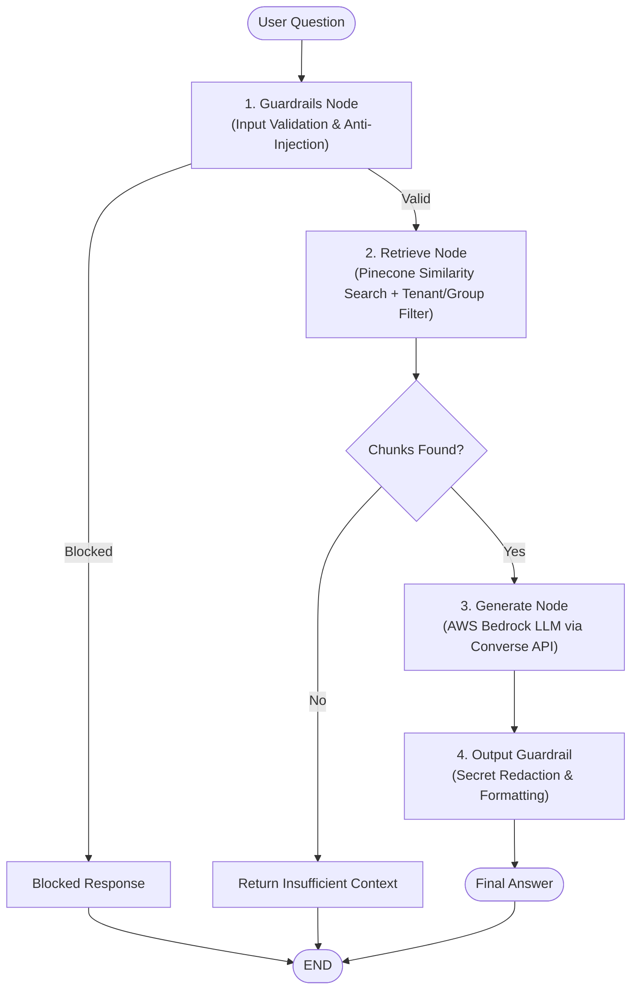

# Enterprise RAG System

An enterprise-grade Retrieval-Augmented Generation (RAG) system built with **FastAPI**, **LangGraph**, **Pinecone**, and **AWS Bedrock**. Features multi-tenant data isolation, role-based access filtering, input/output guardrails, and observable state-driven orchestration.

---

## Architecture Overview



---

## Key Features

- **LangGraph Workflow**: Deterministic state machine managing query guardrails, context retrieval, branching, and answer generation.
- **Vector Storage (Pinecone)**: Serverless vector database with tenant namespaces (`tenant-{tenant}`) and metadata filtering (`allowed_groups`, `owner_sub`).
- **AWS Bedrock Integration**:
  - **Embeddings**: `amazon.titan-embed-text-v2:0` (1024 dimensions)
  - **Chat LLM**: `amazon.nova-micro-v1:0` (via Bedrock Converse API)
- **Security & Guardrails**:
  - Regex-based detection for prompt injections, jailbreaks, and hidden Unicode characters.
  - Automatic redaction of sensitive credentials (AWS keys, JWTs, DB connection strings, Bearer tokens).
- **FastAPI Backend**: High-performance REST endpoints with interactive Swagger UI.

---

## Project Structure

```text
├── app/
│   ├── api/                 # API route definitions
│   │   ├── chat.py
│   │   └── documents.py
│   ├── core/                # Core configurations and infrastructure
│   │   ├── aws.py           # Boto3 Bedrock client factory
│   │   ├── config.py        # Pydantic Settings (.env loader)
│   │   ├── db.py            # SQLAlchemy database engine and session
│   │   └── observability.py # Observability & tracing
│   ├── llm/                 # Model adapters & prompt templates
│   │   ├── bedrock.py
│   │   ├── factory.py
│   │   └── prompt.py
│   ├── rag/                 # RAG pipeline components
│   │   ├── embedding.py     # Bedrock text embedding
│   │   ├── ingestion.py     # Document chunking & upserting
│   │   └── retrieval.py     # Pinecone vector retrieval
│   ├── graph.py             # LangGraph state graph definition
│   ├── guardrails.py        # Input & output safety guardrails
│   ├── main.py              # FastAPI app entrypoint & test endpoints
│   ├── model.py             # Database models
│   └── vector_pinecone.py   # Pinecone index management & search
├── tests/                   # Test scripts (Bedrock, Pinecone)
├── requirements.txt         # Python dependencies
├── sample_test.txt          # Sample document for testing ingestion
└── README.md
```

---

## Getting Started

### 1. Prerequisites

- Python 3.10+
- AWS Account with Bedrock model access (`amazon.titan-embed-text-v2:0` & `amazon.nova-micro-v1:0`)
- Pinecone Account and API key

### 2. Installation

1. **Clone the repository:**
   ```bash
   git clone <repo-url>
   cd RAG_system
   ```

2. **Set up a virtual environment:**
   ```bash
   python3 -m venv .venv
   source .venv/bin/activate
   ```

3. **Install dependencies:**
   ```bash
   pip install -r requirements.txt
   ```

### 3. Environment Variables

Create a `.env` file in the project root:

```env
# AWS Configuration
AWS_REGION=us-east-1
AWS_ACCESS_KEY_ID=your_aws_access_key
AWS_SECRET_ACCESS_KEY=your_aws_secret_key
BEDROCK_EMBED_MODEL=amazon.titan-embed-text-v2:0
BEDROCK_CHAT_MODEL=amazon.nova-micro-v1:0
EMBED_DIM=1024
EMBED_NORMALIZE=True

# Pinecone Configuration
PINECONE_API_KEY=your_pinecone_api_key
PINECONE_INDEX_NAME=rag-index
PINECONE_CLOUD=aws
PINECONE_REGION=us-east-1
PINECONE_READY_TIMEOUT=180

# Database Configuration (SQLite default)
DATABASE_URL=sqlite:///./rag-system.db

# Observability (Optional)
RIUS_API_KEY=your_rius_key
RIUS_SERVICE_NAME=rag-service
RIUS_DISABLED=True
```

---

## Running the Application

Start the FastAPI development server:

```bash
uvicorn app.main:app --reload --host 0.0.0.0 --port 8000
```

The interactive API documentation (Swagger) is available at:
- **Swagger UI**: [http://127.0.0.1:8000/docs](http://127.0.0.1:8000/docs)
- **ReDoc**: [http://127.0.0.1:8000/redoc](http://127.0.0.1:8000/redoc)

---

## Quick Testing

### 1. Upload & Ingest a Document
Upload and chunk [`sample_test.txt`](sample_test.txt) into Pinecone:

```bash
curl -X POST "http://127.0.0.1:8000/test-upload"
```

### 2. Query the Knowledge Base
Run a question through the full guardrail + retrieval + LLM flow:

```bash
curl "http://127.0.0.1:8000/test-query?question=What+is+Pinecone%3F"
```

---

## License

This project is licensed under the MIT License.
