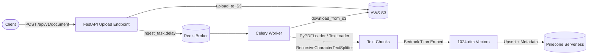
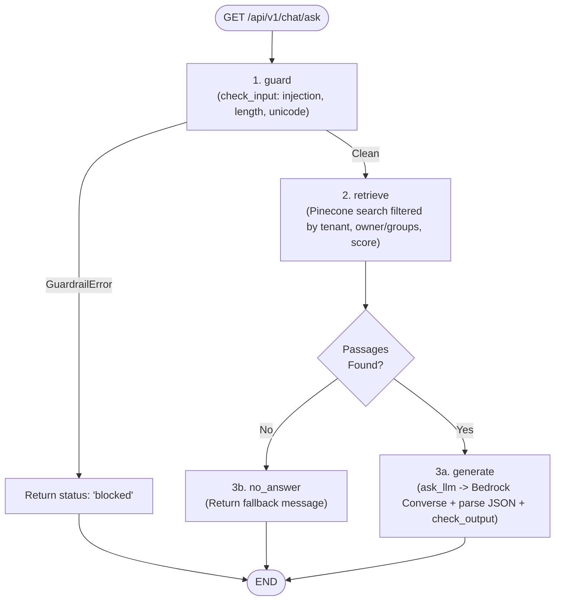

# Enterprise RAG System

An enterprise-grade Retrieval-Augmented Generation (RAG) backend built with **FastAPI**, **LangGraph**, **Celery + Redis**, **Pinecone**, and **AWS Bedrock / S3**. Features asynchronous document ingestion, multi-tenant namespace isolation, owner/group-based access filtering, input/output guardrails, and Rius observability.

---

## Architecture Overview

### 1. Document Ingestion Flow (Async with Celery & S3)


### 2. Query / Chat Flow (LangGraph)


---

## Key Features

- **Async Document Ingestion**: Uploads `.pdf`, `.md`, and `.txt` files (up to 5 MB on the upload route) to AWS S3 and processes chunking/embedding asynchronously via Celery workers with automatic retries.
- **LangGraph Orchestration**: State-driven RAG pipeline (`guard` $\to$ `retrieve` $\to$ `generate` / `no_answer`) in `app/graph.py`.
- **Multi-Tenant & Access Control**: Pinecone namespaces (`tenant-{tenant}`) with metadata filtering on `owner_sub` and `allowed_groups`, plus configurable `MIN_RELEVANCE_SCORE` filtering.
- **AWS Bedrock & Pluggable LLM Factory**:
  - **Embeddings**: `amazon.titan-embed-text-v2:0` (`1024` dimensions)
  - **Chat LLM**: `amazon.nova-micro-v1:0` via Bedrock Converse API (extensible through `app/llm/factory.py`)
- **Input & Output Guardrails**: Blocks prompt injection/jailbreak attempts and redacts leaked secrets (AWS keys, JWTs, DB URLs, Bearer tokens, API keys) before returning answers.
- **Observability**: Privacy-first tracing via `glassflow-rius` (`@trace`, `initialize()`).

---

## Project Structure

```text
├── app/
│   ├── api/
│   │   ├── chat.py           # GET /api/v1/chat/ask endpoint
│   │   └── documents.py      # POST /api/v1/document & /process/{task_id} endpoints
│   ├── core/
│   │   ├── aws.py            # Boto3 client, upload_to_S3, download_from_s3
│   │   ├── config.py         # Pydantic Settings (.env loader)
│   │   ├── db.py             # SQLAlchemy engine, Base, session dependency
│   │   ├── observability.py  # Rius tracing initialization and @trace decorator
│   │   └── security.py       # Principal dataclass and get_principal dependency
│   ├── llm/
│   │   ├── bedrock.py        # AWS Bedrock Converse API integration
│   │   ├── factory.py        # LLM provider registry (ask_llm)
│   │   └── prompt.py         # Prompt templates
│   ├── rag/
│   │   ├── embedding.py      # Bedrock Titan embedding helper
│   │   ├── ingestion.py      # S3 download, document loaders, chunking, Pinecone upsert
│   │   └── retrieval.py      # Pinecone retrieval wrapper
│   ├── graph.py              # LangGraph StateGraph & chat() entrypoint
│   ├── guardrails.py         # check_input & check_output guardrails
│   ├── main.py               # FastAPI app setup & router registration
│   ├── memory.py             # Conversation history placeholders
│   ├── model.py              # SQLAlchemy ORM models
│   └── vector_pinecone.py    # Pinecone index setup, upsert, search, delete
├── worker/
│   ├── celery_app.py         # Celery app configuration (Redis broker/backend)
│   └── tasks.py              # Async ingest_task definition
├── tests/                    # Test scripts
├── requirements.txt          # Python dependencies
├── sample_test.txt           # Sample text file
└── README.md
```

---

## Getting Started

### 1. Prerequisites

- Python 3.12+ (or 3.10+)
- **Redis** (used as Celery broker and result backend)
- **AWS Account** with an S3 bucket and Bedrock model access (`amazon.titan-embed-text-v2:0` and `amazon.nova-micro-v1:0`)
- **Pinecone** account and API key

### 2. Installation

1. **Create and activate a virtual environment:**
   ```bash
   python3 -m venv .venv
   source .venv/bin/activate
   ```

2. **Install dependencies:**
   ```bash
   pip install -r requirements.txt
   ```

### 3. Environment Variables

Create a `.env` file in the project root (see `.env.example`):

```env
# AWS Configuration
AWS_REGION=us-east-1
AWS_ACCESS_KEY_ID=your_aws_access_key
AWS_SECRET_ACCESS_KEY=your_aws_secret_key
AWS_S3_BUCKET_NAME=your_s3_bucket_name
BEDROCK_EMBED_MODEL=amazon.titan-embed-text-v2:0
BEDROCK_CHAT_MODEL=amazon.nova-micro-v1:0
EMBED_DIM=1024
EMBED_NORMALIZE=True

# Pinecone Configuration
PINECONE_API_KEY=your_pinecone_api_key
PINECONE_INDEX_NAME=your_pinecone_index_name
PINECONE_CLOUD=aws
PINECONE_REGION=us-east-1
PINECONE_READY_TIMEOUT=180

# Retrieval & LLM Settings
LLM_PROVIDER=bedrock
MIN_RELEVANCE_SCORE=0.3

# Database & Redis (Celery)
DATABASE_URL=sqlite:///./rag-system.db
REDIS_URL=redis://localhost:6379

# Observability (Optional)
RIUS_API_KEY=
RIUS_SERVICE_NAME=rag-system
RIUS_DISABLED=True
RIUS_CAPTURE_CONTENT=False
```

---

## Running the Application

1. **Start Redis** (if not already running):
   ```bash
   redis-server
   ```

2. **Start the Celery Worker** (in a separate terminal):
   ```bash
   celery -A worker.celery_app worker --loglevel=info
   ```

3. **Start the FastAPI Server:**
   ```bash
   uvicorn app.main:app --reload --host 0.0.0.0 --port 8000
   ```

Interactive API docs are available at:
- **Swagger UI**: `http://127.0.0.1:8000/docs`
- **ReDoc**: `http://127.0.0.1:8000/redoc`

---

## API Endpoints

| Method | Path | Description |
| :--- | :--- | :--- |
| `GET` | `/` | Root status message |
| `GET` | `/health` | Health check (`{"status": "OK"}`) |
| `POST` | `/api/v1/document` | Upload a `.pdf`, `.md`, or `.txt` file to S3 and queue Celery ingestion |
| `POST` | `/api/v1/document/process/{task_id}` | Check Celery ingestion task state & result |
| `GET` | `/api/v1/chat/ask?question=...` | Query the RAG pipeline through LangGraph |

### Example Usage

**1. Upload & Queue Document Ingestion:**
```bash
curl -X POST "http://127.0.0.1:8000/api/v1/document" \
     -F "file=@sample_test.txt"
```

**2. Check Ingestion Task Status:**
```bash
curl -X POST "http://127.0.0.1:8000/api/v1/document/process/<task_id>"
```

**3. Ask a Question:**
```bash
curl "http://127.0.0.1:8000/api/v1/chat/ask?question=What+is+Pinecone%3F"
```
